# ReconcileAI Pro: Payment Gateway & Financial Reconciliation System

A production-ready MERN application that reconciles **Razorpay gateway settlements** against internal ledgers, detects mismatched, duplicate, and orphan transactions, and generates audit-ready PDF/Excel reports. It also includes AI-powered fuzzy matching, fraud heuristics, subscription billing, and Redis/BullMQ-backed performance.

---

## 📚 Table of Contents

- [Live Demo](#-live-demo)
- [Key Features](#-key-features)
- [Tech Stack](#-tech-stack)
- [Project Structure](#-system-folder-structure)
- [Screenshots](#-screenshots)
- [Getting Started](#-getting-started--local-setup)
- [Security Architecture](#-security-architecture)
- [Contact](#-contact)

---

## 🛰️ Live Demo

[🔗 View Live Demo](https://ai-based-reconciliation-system-frontend.onrender.com)

---

## 🛠 Tech Stack

- **Frontend**: React.js, TypeScript, Tailwind CSS, Vite, Recharts, Lucide Icons, Axios, React Router v6
- **Backend**: Node.js, Express.js, TypeScript, Socket.IO, Multer, PDFKit, XLSX, CSV-Parser, Fuse.js
- **Database & Queue**: MongoDB with Mongoose (index optimizations), Redis (caching), BullMQ (background job processing)
- **Authentication**: JWT, bcrypt password hashing, role-based route security (Admin/User)
- **Payments**: Razorpay (Orders, Webhooks, Subscriptions, Invoice generation)

---

## 📁 System Folder Structure

```text
ai-recon-system/
├── backend/
│   ├── config/             # DB connection, Socket wrappers, Razorpay client, Subscription plans
│   ├── controllers/        # Express handlers (Auth, Recon, Dashboard, Reports, Payment, Subscription)
│   ├── middlewares/        # JWT Protections, Rate Limiters, File uploads, Usage Limit enforcement
│   ├── models/             # Mongoose schemas (User, Transaction, Match, AuditLog, Payment, Subscription, Invoice)
│   ├── routes/             # RESTful API route declarations
│   ├── services/           # Business logic (Reconciliation, Fraud, Exporters, Payment Recon, Invoice Generator, Subscription)
│   ├── utils/              # Algorithms (Levenshtein, Cosine, Seeder script)
│   ├── server.js           # Server Entry point
│   └── package.json
└── frontend/
    ├── src/
    │   ├── context/        # Auth & Dark Theme contexts
    │   ├── layouts/        # Dashboard layout sidebar
    │   ├── pages/          # Login, Dashboard, Workbench, Fraud, Audits, Gateway Recon, Subscriptions & Plans
    │   ├── services/       # API service modules (payment, subscription)
    │   └── App.jsx         # Routes definition
    ├── tailwind.config.js
    └── package.json
```

---

## 📸 Screenshots

### 🔐 Authentication
| Login | Register |
|:----:|:----:|
| 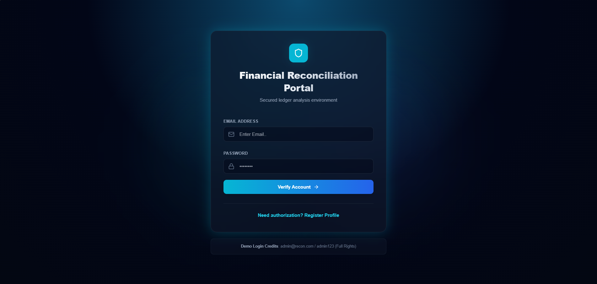 | 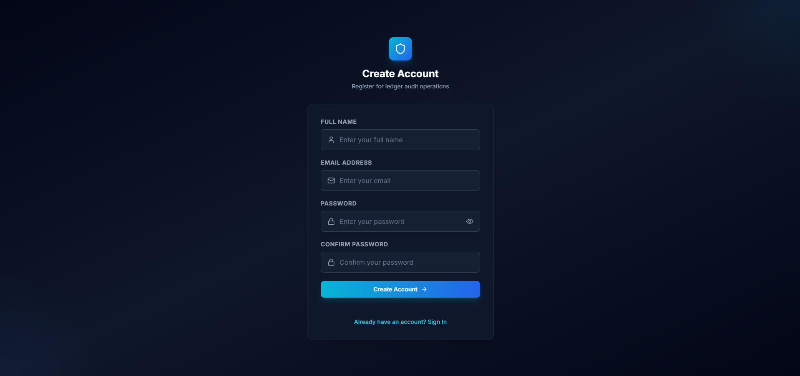 |

### 📊 Dashboard & Workbench
| Dashboard |
|:----:|
| 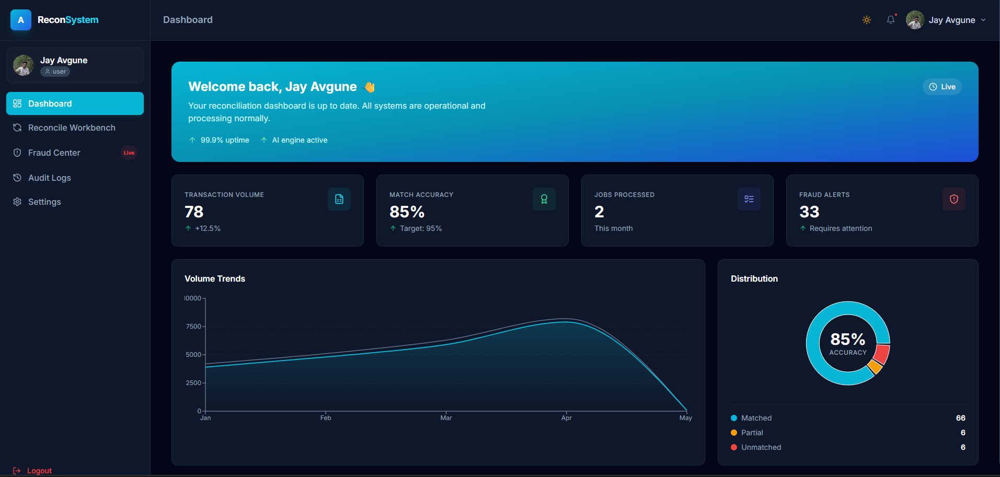 |

### 📁 File Upload
| Upload Interface | Reconciliation Workbench |
|:----:|:----:|
| 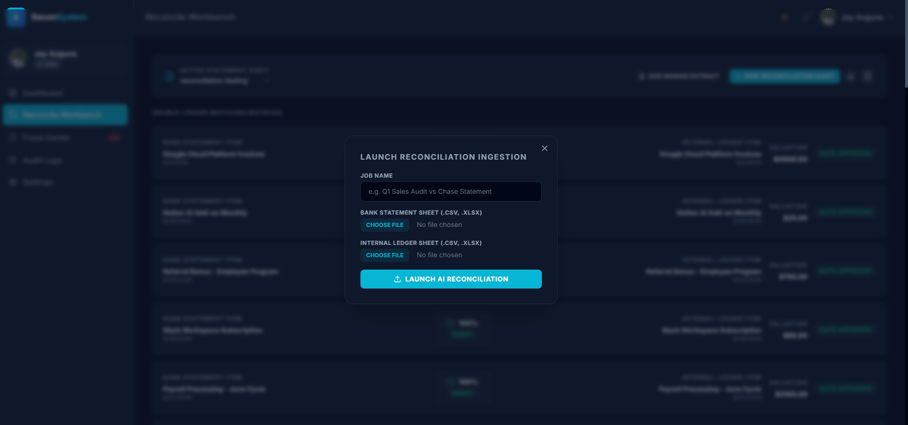 | 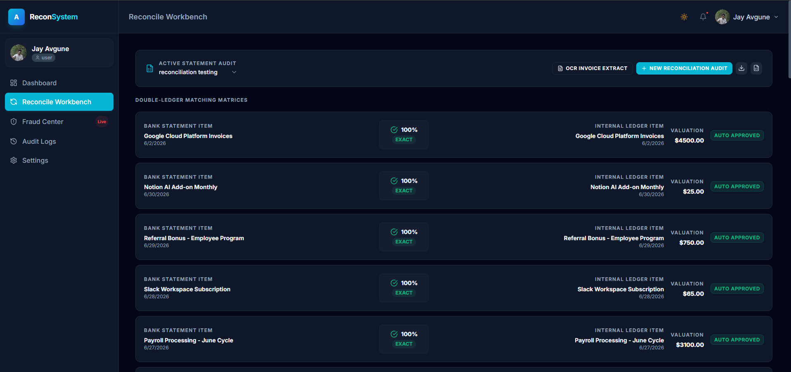 |

### 💳 Gateway Reconciliation & Subscriptions
| Gateway Recon Dashboard | Subscription Plans | Subscription Billing |
|:----:|:----:|:----:|
| 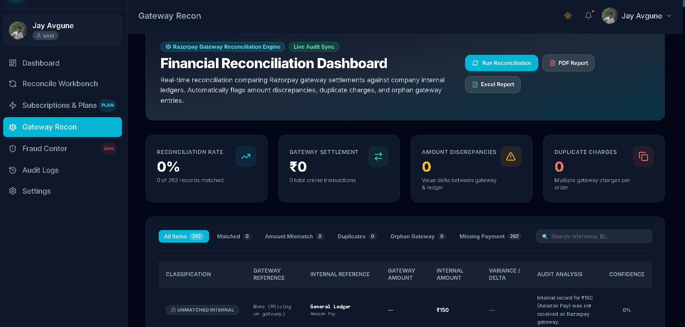 | 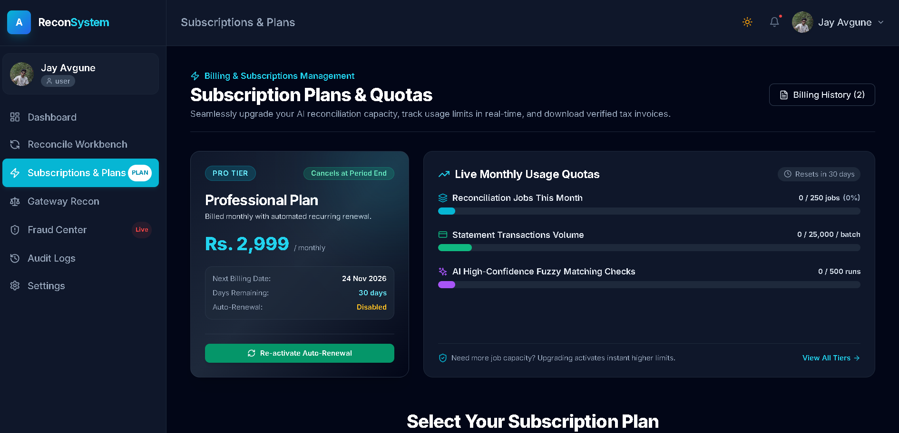 | 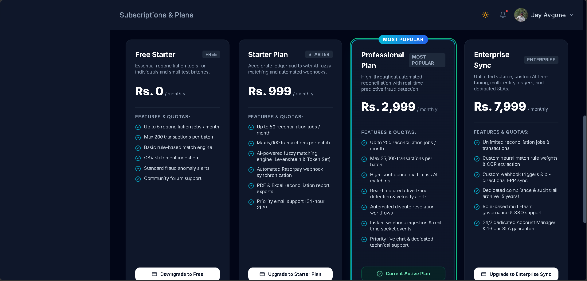 |

### 🚨 Fraud Detection & Audit
| Fraud Alerts | Audit Logs |
|:----:|:----:|
| 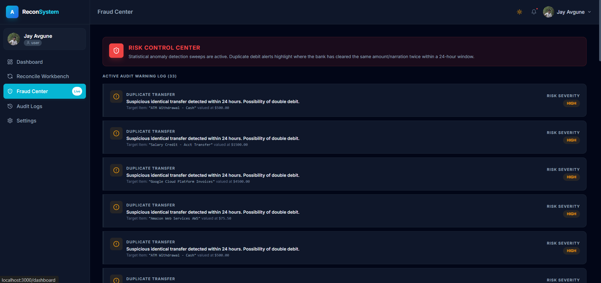 | 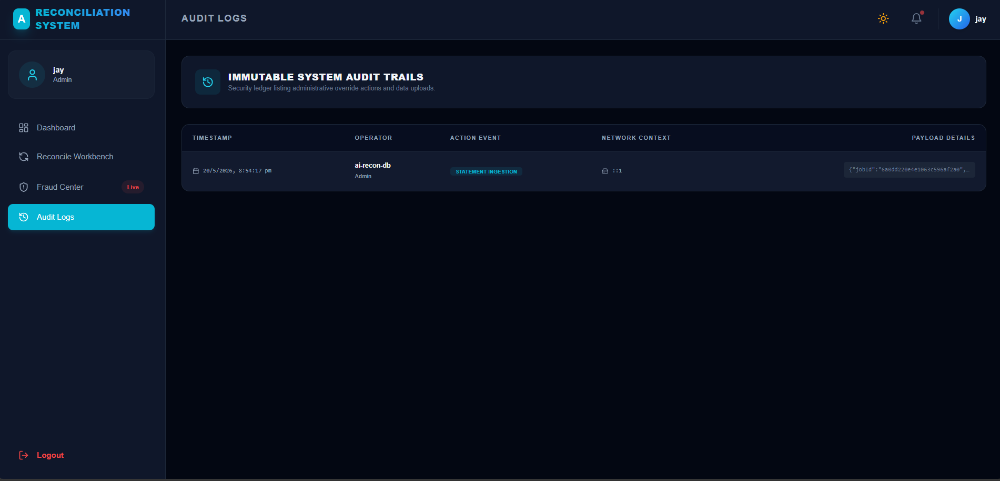 |

### ⚙️ Settings Pages
| Profile Settings | Storage Overview | Password Change |
|:----:|:----:|:----:|
| 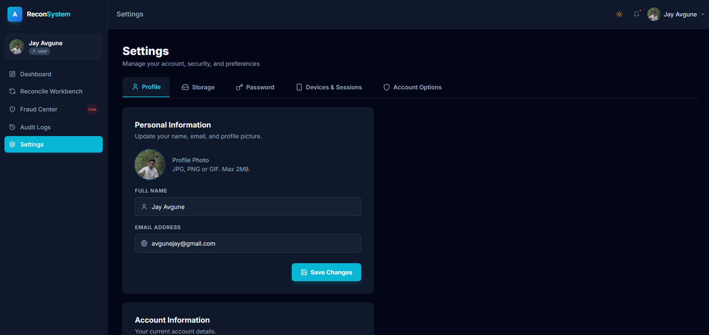 | 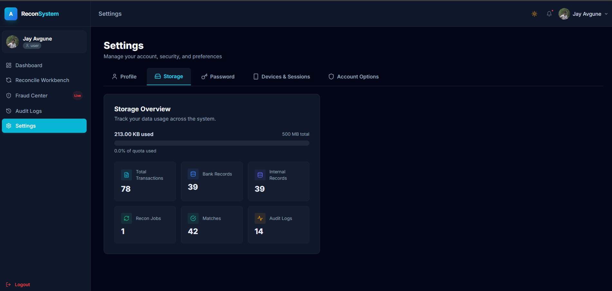 | 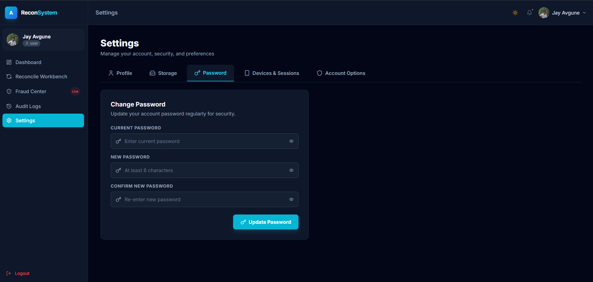 |

| Devices & Sessions | Account Options |
|:----:|:----:|
| 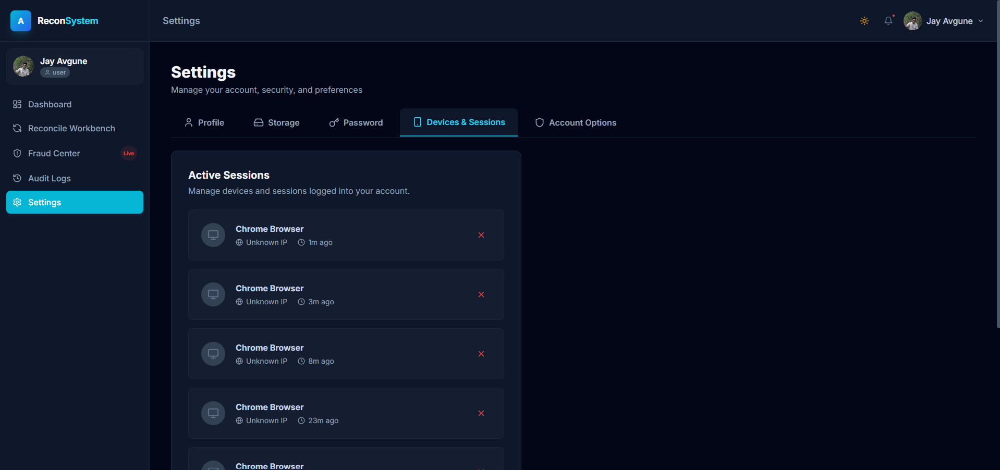 | 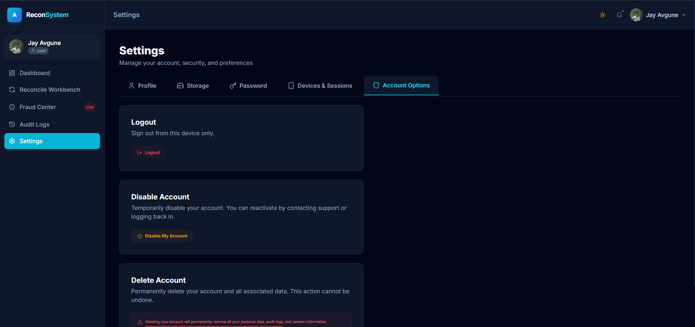 |

---

## 🚀 Key Features

### 1. **Razorpay Payments & Gateway Reconciliation**
- Supports **UPI, Cards, and NetBanking** with secure backend order creation.
- **HMAC-SHA256 signature verification** and **idempotency protection** prevent forged events and duplicate payment processing.
- Reconciliation engine cross-verifies **gateway settlements against internal ledgers**, classifying each row as Matched, Amount Mismatch, Duplicate, Orphan Gateway, or Missing Payment.
- Live audit sync with exportable **PDF** and **Excel** reports.

### 2. **Hybrid AI Matching Engine**
- Multi-pass transaction matching:
  1. **Deterministic filter**: matches on external transaction reference IDs and exact amount/date fits.
  2. **Character N-Gram Cosine Similarity**: measures spelling and word-arrangement similarity (e.g. `AMAZONPAY INDIA` ↔ `Amazon Pay`).
  3. **Jaro-Winkler & Levenshtein distances**: accurate string proximity scoring.
- Assigns a dynamic **Confidence Score %** with natural-language **AI explanations** for each match.

### 3. **Performance: Redis Caching & BullMQ**
- **Redis caching** optimizes data retrieval for dashboards and analytics.
- **BullMQ background processing** handles heavy reconciliation jobs off the request cycle.
- **Socket.IO** streams real-time progress and transaction updates to the dashboard.

### 4. **Subscription Billing & Plan Management**
- Four tiers: **Free Starter**, **Starter (₹999/mo)**, **Professional (₹2,999/mo)**, and **Enterprise Sync (₹7,999/mo)**.
- Live **monthly usage quotas** with progress bars for Reconciliation Jobs, Transaction Volume, and AI Fuzzy Matching Checks.
- **Razorpay checkout** for upgrades and downgrades with webhook-driven status updates.
- **Billing history** with downloadable tax invoices and auto-generated PDF receipts.
- Usage Limit Middleware enforces quotas per API route.

### 5. **Continuous Risk Heuristics (Fraud Detection)**
- **Velocity Spikes**: flags multiple identical debits within a 1-hour window.
- **Double Debits**: alerts on duplicate transfers within 24 hours.
- **Statistical Outliers**: Z-Score (> 2.5) detection of anomalous transaction amounts.

### 6. **Structured Ingestion & Processing**
- Drag-and-drop CSV and Excel upload.
- **Dynamic Headers Normalizer**: auto-maps mismatched column headers (e.g. "UTR No", "Ref ID", "Transaction No" → `transactionId`).
- **Invoice OCR extraction**: demo pipeline using Tesseract.js for text extraction from receipts.

### 7. **Sharing & Permissions**
- Share reconciliation files via email (registered users) or direct link (guest users).
- **Viewer** (read-only) and **Editor** (modify/re-run) roles.
- *Shared by Me* and *Shared with Me* views with real-time permission updates.
- Activity logs track share events; access revocation is instant.

### 8. **Audit & Exports**
- **PDF reconciliation reports** with job summaries and match pairs.
- **Multi-sheet Excel** exports for bookkeeping.
- Full **audit log** of all user actions.

---

## 🏃 Getting Started & Local Setup

### **Prerequisites**
- Node.js (v18 or higher)
- MongoDB (local at `mongodb://localhost:27017` or a MongoDB Atlas connection string)
- Redis server (required for caching and BullMQ)
- A [Razorpay](https://razorpay.com) account with Test API keys

### **Step 1: Backend**
1. Navigate to the backend folder:
   ```bash
   cd backend
   ```
2. Install dependencies:
   ```bash
   npm install
   ```
3. Configure environment variables (copy from `.env.example`):
   ```ini
   PORT=
   MONGO_URI=
   REDIS_URL=
   JWT_SECRET=
   NODE_ENV=

   # Razorpay Payment Gateway
   RAZORPAY_KEY_ID=rzp_test_YourTestKeyIdHere
   RAZORPAY_KEY_SECRET=YourTestKeySecretHere
   RAZORPAY_WEBHOOK_SECRET=YourRazorpayWebhookSecretHere
   ```
4. Seed initial data and default accounts:
   ```bash
   npm run seed
   ```
5. Start the development server:
   ```bash
   npm run dev
   ```

### **Step 2: Frontend**
1. Navigate to the frontend folder:
   ```bash
   cd ../frontend
   ```
2. Install dependencies and start the Vite client:
   ```bash
   npm install
   npm run dev
   ```
3. Open `http://localhost:3000/`

---

## 🔒 Security Architecture

1. **Authentication**: JWT signatures with short TTL, attached to Axios request headers.
2. **Razorpay Webhook Verification**: HMAC-SHA256 signature validation on all incoming webhooks to block forged events.
3. **Idempotency Protection**: prevents double-charging and duplicate payment processing.
4. **API Rate Limiter**: limits uploads to 20 sheets per 5 minutes per IP.
5. **Usage Limit Middleware**: enforces per-plan quotas at the route level before processing begins.
6. **Data Sanitization**: Mongoose schema validation and parameter sanitization against NoSQL injection.
7. **Header Hardening**: `Helmet` to obscure Express fingerprints.
8. **Share Link Tokens**: unique, expirable tokens for guest links with optional passphrase protection.

---

## 📬 Contact

**Jay Avgune** · Full Stack Developer (MERN)

- 💼 [LinkedIn](https://www.linkedin.com/in/jay-avgune-1316b323a)
- 🐙 [GitHub](https://github.com/jayavgune18)
- 🌐 [Portfolio](https://jay-avgune.netlify.app/)
- 📧 [avgunejay@gmail.com](mailto:avgunejay@gmail.com)